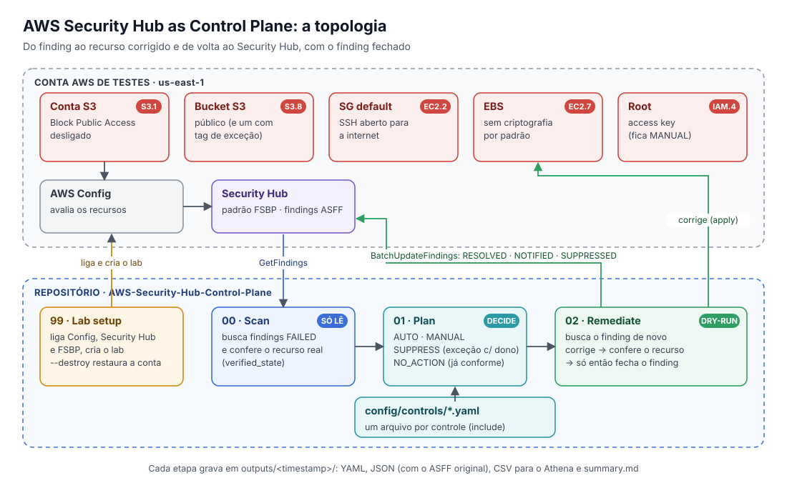

# AWS Security Hub as Control Plane

<p align="center">
  <a href="#-português">Português</a> •
  <a href="#-english">English</a>
</p>

<p align="center">
  
</p>

---

## 🇧🇷 Português

Sabe aquele painel do Security Hub cheio de findings que todo mundo olha, alguém exporta para uma planilha, e três meses depois continua tudo igual? Este repositório existe para mudar isso.

A ideia é simples: em vez de só **olhar** para o Security Hub, a gente passa a **agir** a partir dele. O código lê os findings, confere se o problema ainda existe de verdade, decide o que fazer com cada um e, quando faz sentido, corrige o recurso e fecha o finding com uma nota explicando o que foi feito.

> Este repositório faz parte da série **AWS Security Control Plane** e nasce do template [AWS Security Control Plane Scripts](https://github.com/wagnermazevedo/AWS-Security-Control-Plane-Scripts). Se você já viu o episódio 1, vai se sentir em casa: mesmo contrato, mesmas saídas, mesmo `test-control-plane.sh`.
>
> ⚠️ **Rode numa conta de testes.** O laboratório desliga algumas proteções da conta de propósito, para termos o que corrigir.

### O que você vai aprender aqui

- Usar o Security Hub como **fonte da verdade**, inclusive de compliance (FSBP, CIS, NIST, PCI DSS).
- Decidir o destino de cada controle **antes** do finding aparecer, num arquivo YAML legível.
- **Fechar o ciclo:** corrigir, conferir e só então marcar o finding como resolvido.
- Guardar a evidência de cada execução, para quando alguém perguntar "quem mudou isso e quando?".

### Os controles deste episódio

| Controle | O que ele verifica | O que o código faz |
|---|---|---|
| **S3.1** | Block Public Access ligado na conta | Corrige sozinho (AUTO) |
| **S3.8** | Block Public Access ligado no bucket | Corrige sozinho (AUTO) |
| **EC2.2** | Security group `default` sem regras | Corrige sozinho (AUTO), e só mexe em SG chamado `default` |
| **EC2.7** | Criptografia de EBS ligada por padrão | Corrige sozinho (AUTO) |
| **IAM.4** | Usuário root sem access key | Avisa e aponta o runbook (MANUAL) |

Repare no IAM.4: ele fica manual de propósito. Nem tudo deve ser corrigido por script, e chave de root é o melhor exemplo disso.

### Como funciona: scan, plan e remediate

Pense em três etapas, cada uma com uma responsabilidade só:

1. **Scan, que só olha.** Busca os findings com falha dos controles do mapa e, para cada um, consulta o recurso de verdade. Isso importa porque alguns controles são reavaliados de tempos em tempos, e o finding pode estar atrasado em relação à realidade.
2. **Plan, que só decide.** Cruza cada finding com o mapa de controles (`config/remediate_map.yaml` e os arquivos de `config/controls/`) e escreve um plano: corrigir (`AUTO`), avisar (`MANUAL`), aceitar como exceção (`SUPPRESS`) ou não fazer nada porque já está tudo certo (`NO_ACTION`).
3. **Remediate, que age com cuidado.** Por padrão roda em dry-run e só mostra o que faria. No modo apply, busca o finding de novo, corrige, confere se ficou certo e só então marca como `RESOLVED`. Itens manuais viram `NOTIFIED` e exceções viram `SUPPRESSED`, sempre com uma nota.

> **A regra de ouro:** nada é corrigido sem querer. Em dry-run, nenhuma API de escrita é chamada, nem no recurso, nem no Security Hub.

**E as exceções?** Às vezes um bucket precisa mesmo ser público. Nesse caso, coloque nele a tag `scp-exception` com o motivo e a tag `exception-owner` com o responsável. O finding vira `SUPPRESSED`, com a justificativa registrada. Sem dono, não vale: volta para `MANUAL`.

**E se o formato dos findings mudar?** Todo o conhecimento sobre o formato ASFF está num arquivo só, o `scanner/findings.py`. Se um dia a fonte passar a ser OCSF (Security Lake ou a nova geração do Security Hub), basta trocar esse leitor.

### Mão na massa no AWS CloudShell

**1. Clone e instale**

```bash
cd ~
git clone https://github.com/wagnermazevedo/AWS-Security-Hub-Control-Plane.git
cd AWS-Security-Hub-Control-Plane
pip3 install --user -r requirements.txt
```

**2. Monte o laboratório**

```bash
python3 scripts/99_securityhub_lab_setup.py --region us-east-1
```

O script 99 prepara tudo para os outros scripts: liga o AWS Config, o Security Hub e o padrão FSBP, guarda como a conta estava, desliga o Block Public Access da conta e a criptografia de EBS por padrão, e sobe um CloudFormation com um bucket público e um security group aberto.

Uma dica: o S3.8 e o EC2.2 aparecem em minutos, mas o S3.1 e o EC2.7 são avaliados periodicamente e podem levar algumas horas. Vale rodar o setup com antecedência.

**3. Rode o ciclo**

```bash
python3 scripts/00_securityhub_scan.py --region us-east-1
python3 scripts/01_securityhub_plan.py \
  --input-yaml outputs/<timestamp>/securityhub_findings_export.yaml \
  --rules config/remediate_map.yaml \
  --output-yaml outputs/remediation_plan.yaml
python3 scripts/02_securityhub_remediate.py --region us-east-1 --yaml outputs/remediation_plan.yaml --mode dry-run
python3 scripts/02_securityhub_remediate.py --region us-east-1 --yaml outputs/remediation_plan.yaml --mode apply
```

Se preferir, o orquestrador do template faz tudo de uma vez (rode a partir do `$HOME`):

```bash
~/AWS-Security-Hub-Control-Plane/test-control-plane.sh AWS-Security-Hub-Control-Plane dry-run
```

**4. Arrume a casa**

```bash
python3 scripts/99_securityhub_lab_setup.py --region us-east-1 --destroy
```

Remove o laboratório e devolve a conta exatamente como estava antes do setup. O Security Hub e o Config continuam ligados.

### Quer adicionar um controle novo?

Esse é o melhor jeito de aprender como o repositório funciona. Usando o **GuardDuty.1** (GuardDuty habilitado) como exemplo:

1. **Crie o arquivo do controle.** Cada controle mora no seu próprio arquivo em `config/controls/`, e o `remediate_map.yaml` inclui todos com `include: [controls/*.yaml]`. Crie `config/controls/GuardDuty.1.yaml`:

   ```yaml
   id: GuardDuty.1
   title: "GuardDuty habilitado"
   decision: AUTO              # AUTO, MANUAL ou SUPPRESS
   action: guardduty_enable    # só para AUTO: o nome registrado em remediate/__init__.py
   severity: HIGH
   # opcionais: reason e runbook (MANUAL/SUPPRESS), note (aviso no plano), expected (estado esperado)
   # enabled: false            # desliga o controle sem apagar o arquivo
   ```

   Só isso já faz o scan buscar os findings dele e o plan decidir sobre eles. Se um ID aparecer duas vezes, ou um AUTO vier sem `action`, o scan e o plan param com uma mensagem clara. O apply executa o que o plan decidiu, então ele também segue os arquivos incluídos.
2. **Ensine o código a conferir o recurso.** Em `scanner/resources.py`, escreva uma função que devolve `COMPLIANT` ou `NONCOMPLIANT` e registre em `VERIFIERS`.
3. **Escreva a correção (se for AUTO).** Crie `remediate/guardduty_1.py` com uma função `run(clients, ctx, dry_run)` que devolve `ok`, `message` e `changes`. Em dry-run ela só descreve o que faria. Depois registre o nome da ação em `remediate/__init__.py`.
4. **Precisa de outro serviço da AWS?** Adicione o nome dele em `SERVICES`, no `lib/aws.py`.
5. **Recurso com ID próprio?** Se o controle aponta para um recurso (como um bucket), ensine o `resource_locator` em `scanner/findings.py` a achar o identificador dele, e o `resource_tags` em `scanner/resources.py` a ler as tags, para as exceções funcionarem.
6. **Coloque no laboratório e teste.** Crie o caso inseguro no `lab_insecure/insecure-stack.yaml` (ou no script 99, para configurações de conta), adicione o finding falso em `tests/fakes.py` e rode `python3 -m unittest discover -s tests -v`.

### O que fica salvo em cada execução

Cada execução cria uma pasta nova em `outputs/<timestamp>/`, e nada é sobrescrito:

- **YAML** (`securityhub_findings_export.yaml`): a entrada do plan.
- **JSON:** a fonte da verdade, com o finding original completo.
- **CSV:** pronto para consultar no Amazon Athena.
- **Markdown** (`summary.md`): um resumo para ler rápido.

O remediate grava JSON, CSV e Markdown, mas não YAML, para o `test-control-plane.sh` continuar achando o YAML do scan mais recente. E se o orquestrador anonimizar o plano, tudo bem: o remediate pega a conta pela credencial em uso e busca os findings de novo.

### Permissões necessárias

- **Scan:** `securityhub:GetFindings`, `s3:GetAccountPublicAccessBlock`, `s3:GetBucketPublicAccessBlock`, `s3:GetBucketTagging`, `ec2:DescribeSecurityGroups`, `ec2:GetEbsEncryptionByDefault`, `iam:GetAccountSummary`, `sts:GetCallerIdentity`
- **Apply:** além das de scan, `securityhub:BatchUpdateFindings`, `s3:PutAccountPublicAccessBlock`, `s3:PutBucketPublicAccessBlock`, `ec2:RevokeSecurityGroupIngress`, `ec2:RevokeSecurityGroupEgress`, `ec2:EnableEbsEncryptionByDefault`

### Testes

```bash
python3 -m unittest discover -s tests -v
```

Os testes rodam o ciclo inteiro numa conta simulada, sem precisar de AWS, e validam cada chamada contra o modelo oficial da API do botocore. Se você escrever um parâmetro errado, o teste avisa antes da AWS.

### Onde fica cada coisa

```text
AWS-Security-Hub-Control-Plane/
├── test-control-plane.sh          # Orquestrador de testes do template
├── scripts/
│   ├── 00_securityhub_scan.py     # Olha
│   ├── 01_securityhub_plan.py     # Decide
│   ├── 02_securityhub_remediate.py  # Age
│   └── 99_securityhub_lab_setup.py  # Monta e desmonta o laboratório
├── config/
│   ├── remediate_map.yaml         # Exceções e o include dos controles
│   └── controls/                  # Um arquivo por controle (S3.1.yaml, IAM.4.yaml...)
├── scanner/                       # Leitura dos findings e do estado real
├── remediate/                     # Uma correção pequena por controle
├── lab_insecure/                  # CloudFormation do laboratório
├── tests/                         # Testes offline
├── lib/                           # Clientes AWS e gravação das saídas
├── reports/                       # Relatórios consolidados
├── outputs/                       # Saídas de cada execução
└── docs/                          # Arquitetura, controles e topologia
```

### Desafio da semana

Adote um controle! Siga o passo a passo acima com o GuardDuty.1 (ou outro de sua escolha) e mande um pull request. Os melhores aparecem no próximo episódio.

---

## 🇺🇸 English

You know that Security Hub dashboard full of findings that everyone looks at, someone exports to a spreadsheet, and three months later nothing has changed? This repository is here to fix that.

Instead of just **looking** at Security Hub, we **act** on it. The code reads the findings, checks whether the problem is still real, decides what to do with each one and, when it makes sense, fixes the resource and closes the finding with a note explaining what was done.

> Part of the **AWS Security Control Plane** series, created from the [AWS Security Control Plane Scripts](https://github.com/wagnermazevedo/AWS-Security-Control-Plane-Scripts) template.
>
> ⚠️ **Use a test account.** The lab turns off some account protections on purpose.

### Controls

| Control | What it checks | What the code does |
|---|---|---|
| **S3.1** | Account-level S3 Block Public Access | Fixes it (AUTO) |
| **S3.8** | Bucket-level S3 Block Public Access | Fixes it (AUTO) |
| **EC2.2** | Default security group has no rules | Fixes it (AUTO), `default` SGs only |
| **EC2.7** | EBS encryption by default | Fixes it (AUTO) |
| **IAM.4** | Root user has no access key | Notifies with a runbook (MANUAL) |

### How it works

1. **Scan only looks:** it fetches failed findings and checks the real resource.
2. **Plan only decides:** `AUTO`, `MANUAL`, `SUPPRESS` or `NO_ACTION`, based on the control files in `config/controls/` (included by `config/remediate_map.yaml`).
3. **Remediate acts carefully:** dry-run by default; in apply mode it fixes, verifies, and only then marks the finding `RESOLVED`. Resources tagged `scp-exception` with an `exception-owner` become `SUPPRESSED`.

### Quick start (AWS CloudShell)

```bash
cd ~ && git clone https://github.com/wagnermazevedo/AWS-Security-Hub-Control-Plane.git
cd AWS-Security-Hub-Control-Plane && pip3 install --user -r requirements.txt
python3 scripts/99_securityhub_lab_setup.py --region us-east-1           # build the lab
~/AWS-Security-Hub-Control-Plane/test-control-plane.sh AWS-Security-Hub-Control-Plane dry-run
python3 scripts/99_securityhub_lab_setup.py --region us-east-1 --destroy # clean up
```

### Adding a new control

1. Create `config/controls/<ID>.yaml` (`id`, `title`, `decision`, `action`, `severity`); `remediate_map.yaml` includes every file in that folder.
2. Add a verifier to `VERIFIERS` in `scanner/resources.py`.
3. For AUTO controls, add `remediate/<control>.py` with `run(clients, ctx, dry_run)` and register it in `remediate/__init__.py`.
4. New AWS service? Add it to `SERVICES` in `lib/aws.py`.
5. Resource-level control? Teach `resource_locator` and `resource_tags` how to find it.
6. Add the insecure case to the lab, a fake finding to `tests/fakes.py`, and run the tests.

### Outputs and tests

Every run writes a new `outputs/<timestamp>/` folder (YAML, JSON, CSV for Athena, and `summary.md`) that is never overwritten. Offline tests: `python3 -m unittest discover -s tests -v`.
